# Домашнее задание к занятию «Настройка приложений и управление доступом в Kubernetes»

Стенд: Oracle VirtualBox VM (Ubuntu 24.04.4 LTS), MicroK8s **v1.35.6** (один узел), `kubectl` **v1.37.1**,
OpenSSL **3.0.13**. Всё выполнено в namespace `default`.

Манифесты лежат в каталоге [`manifests/`](manifests/):

| Файл | Объект | Задание |
|---|---|---|
| [`configmap-web.yaml`](manifests/configmap-web.yaml) | ConfigMap `web-content` со страницей `index.html` | 1 |
| [`deployment.yaml`](manifests/deployment.yaml) | Deployment `web-app` (nginx + multitool) | 1 |
| [`service.yaml`](manifests/service.yaml) | Service `web-app-svc` (нужен Ingress'у) | 2 |
| [`secret-tls.yaml`](manifests/secret-tls.yaml) | Secret `tls-secret` с сертификатом и ключом | 2 |
| [`ingress-tls.yaml`](manifests/ingress-tls.yaml) | Ingress `web-app-ingress` с TLS | 2 |
| [`role-pod-reader.yaml`](manifests/role-pod-reader.yaml) | Role `pod-reader` | 3 |
| [`rolebinding-developer.yaml`](manifests/rolebinding-developer.yaml) | RoleBinding `developer-pod-reader` | 3 |

Сырые логи команд — в [`logs/`](logs/), скриншоты — в [`img/`](img/).

## Где шаблоны из задания пришлось исправить

Шаблоны манифестов в задании «учебные», и если применить их как есть, часть не заработает. Что я поменял и почему:

1. **ConfigMap и Deployment ссылаются на разные имена.** Шаблон Deployment монтирует ConfigMap `nginx-config` в
   `/etc/nginx/conf.d`, а в шаблоне ConfigMap имя `web-content` и ключ `index.html`. Если смонтировать страницу в
   `conf.d`, там пропадёт `default.conf`, и nginx останется без server-блока. Я монтирую `web-content` в каталог
   страниц nginx, `/usr/share/nginx/html`.
2. **В шаблоне Deployment нет контейнера multitool**, хотя задание просит nginx + multitool. Добавлен контейнер, и ему
   сразу заданы `HTTP_PORT=1180` и `HTTPS_PORT=11443`: оба контейнера делят сетевое пространство Pod'а, а multitool
   по умолчанию тоже слушает порт 80 (подробно это разбиралось в прошлом ДЗ, там без этих переменных контейнер
   падает с `bind() ... Address in use`).
3. **Пометки `# ИЗМЕНИТЕ` внутри HTML.** В шаблоне ConfigMap они стоят внутри блока `index.html: |`, то есть стали бы
   текстом на странице. Убраны. Заодно добавлен `<meta charset="utf-8">`, иначе русский текст может отобразиться
   кракозябрами.
4. **`nginx:latest`** заменён на закреплённый тег `nginx:1.29-alpine`.
5. **Глагол `describe` в Role.** В шаблоне Role среди `verbs` есть `describe`, но такого глагола в API Kubernetes
   нет. Я проверил это экспериментом, см. п. 3.4. В моей Role только `get`, `list`, `watch`.
6. **Нет Service.** Ingress направляет трафик на Service, а в шаблонах его нет, поэтому добавлен
   [`service.yaml`](manifests/service.yaml).

## Задание 1. Работа с ConfigMaps

### 1.1. Манифесты

[`manifests/configmap-web.yaml`](manifests/configmap-web.yaml):

```yaml
apiVersion: v1
kind: ConfigMap
metadata:
  name: web-content
data:
  # ключ index.html станет файлом index.html в каталоге, куда смонтирован ConfigMap
  index.html: |
    <!DOCTYPE html>
    <html lang="ru">
    <head>
      <meta charset="utf-8">
      <title>Страница из ConfigMap</title>
    </head>
    <body>
      <h1>Привет от Kubernetes!</h1>
      <p>Эта страница лежит в ConfigMap web-content и подключена к nginx как файл.</p>
    </body>
    </html>
```

[`manifests/deployment.yaml`](manifests/deployment.yaml):

```yaml
apiVersion: apps/v1
kind: Deployment
metadata:
  name: web-app
spec:
  replicas: 1
  selector:
    matchLabels:
      app: web-app
  template:
    metadata:
      labels:
        app: web-app
    spec:
      containers:
        - name: nginx
          image: nginx:1.29-alpine
          ports:
            - containerPort: 80
          volumeMounts:
            # страница из ConfigMap подменяет каталог с html у nginx
            - name: web-content
              mountPath: /usr/share/nginx/html
              readOnly: true
        - name: multitool
          image: wbitt/network-multitool:3.24.4
          # nginx уже занял порт 80 в общем сетевом пространстве Pod'а, поэтому multitool уводим на другие порты
          env:
            - name: HTTP_PORT
              value: "1180"
            - name: HTTPS_PORT
              value: "11443"
          ports:
            - containerPort: 1180
      volumes:
        - name: web-content
          configMap:
            name: web-content
```

### 1.2. Запуск

```bash
kubectl apply -f manifests/configmap-web.yaml -f manifests/deployment.yaml -f manifests/service.yaml
kubectl rollout status deployment/web-app --timeout=120s
kubectl get configmap web-content
kubectl get deploy,pods,svc
```

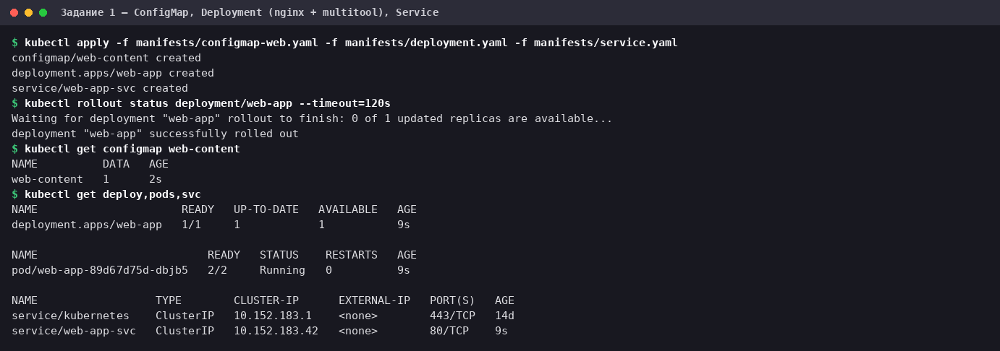

Pod `2/2 Running`: оба контейнера работают, конфликта портов нет.

### 1.3. Проверка доступности

```bash
kubectl exec deploy/web-app -c nginx -- ls -la /usr/share/nginx/html
kubectl exec deploy/web-app -c multitool -- curl -s localhost:80
curl -s http://$(kubectl get svc web-app-svc -o jsonpath="{.spec.clusterIP}")/
```

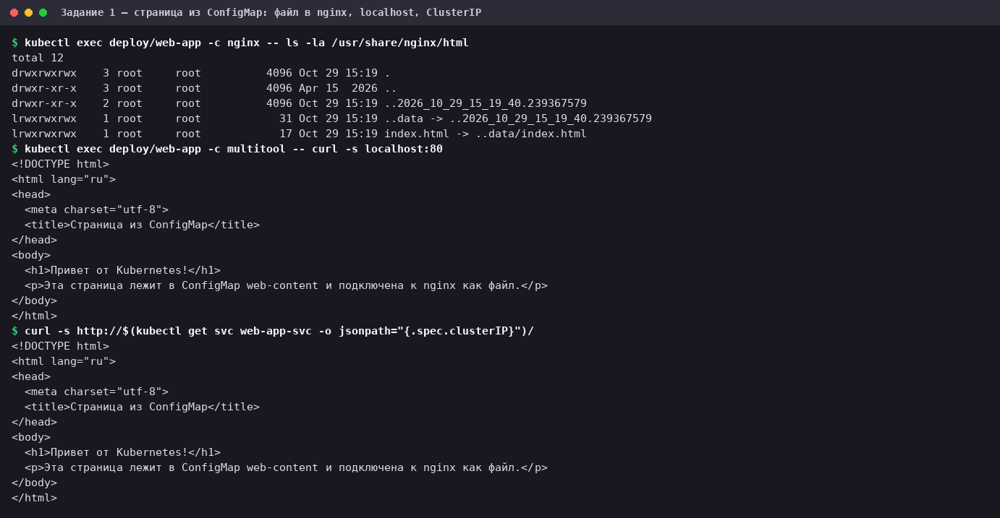

- В каталоге nginx `index.html` — это символическая ссылка `index.html -> ..data/index.html`: так kubelet
  выкладывает файлы смонтированного ConfigMap. Это и есть доказательство, что страница пришла из ConfigMap.
- Из контейнера multitool на `localhost:80` отвечает nginx: контейнеры одного Pod'а делят сетевой стек.
- Через ClusterIP Service страница отдаётся с самой VM (она же узел кластера).

ConfigMap смонтирован каталогом, без `subPath`. По документации Kubernetes в таком случае правка ConfigMap со
временем доезжает до Pod'а без его перезапуска, а при монтировании через `subPath` не доезжает (я этого здесь
экспериментом не проверял).

## Задание 2. HTTPS с Secret и Ingress

### 2.1. Сертификат

Команда из задания с одной добавкой: `2>/dev/null` убирает из вывода прогресс-точки OpenSSL (они идут в stderr).
Ключ и сертификат пишутся в каталог `certs/`, он в `.gitignore`.

```bash
openssl req -x509 -nodes -days 365 -newkey rsa:2048 -keyout certs/tls.key -out certs/tls.crt -subj "/CN=myapp.example.com" 2>/dev/null
openssl x509 -in certs/tls.crt -noout -subject -issuer -dates
ls -l certs/
```

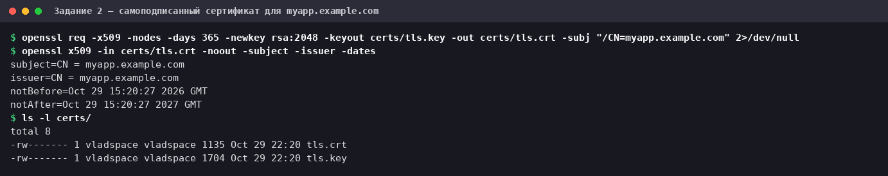

> **Про SAN.** По команде из задания в сертификате нет `subjectAltName`, только `CN`. `curl` такой сертификат
> принимает (это видно ниже), но браузеры и Go-клиенты сверяют имя хоста только по SAN и такой сертификат
> отвергнут. Для реальной работы к команде стоит добавить `-addext "subjectAltName=DNS:myapp.example.com"`.

### 2.2. Secret

[`manifests/secret-tls.yaml`](manifests/secret-tls.yaml) собран из сертификата и ключа, как предлагает шаблон
(`base64 -w 0`):

```bash
cat > manifests/secret-tls.yaml <<EOF
apiVersion: v1
kind: Secret
metadata:
  name: tls-secret
type: kubernetes.io/tls
data:
  tls.crt: $(base64 -w 0 certs/tls.crt)
  tls.key: $(base64 -w 0 certs/tls.key)
EOF
```

Получается такой манифест (длинные значения base64 сокращены, полный файл — по ссылке выше):

```yaml
apiVersion: v1
kind: Secret
metadata:
  name: tls-secret
type: kubernetes.io/tls
data:
  tls.crt: LS0tLS1CRUdJTiBDRVJUSUZJQ0FURS0tLS0tCk1JSURH...
  tls.key: LS0tLS1CRUdJTiBQUklWQVRFIEtFWS0tLS0tCk1JSUV2...
```

> **Важно про ключ в репозитории.** Сертификат демонстрационный: самоподписанный, для вымышленного имени
> `myapp.example.com`, поднят только на этой VM, поэтому его ключ в `secret-tls.yaml` ничего не защищает. В реальной
> работе Secret с настоящим ключом в git не кладут (для этого есть Sealed Secrets, SOPS, External Secrets Operator).
> Ключи и сертификат пользователя `developer` из задания 3 в репозиторий не попадают совсем.

```bash
kubectl apply -f manifests/secret-tls.yaml
kubectl get secret tls-secret
kubectl describe secret tls-secret
```

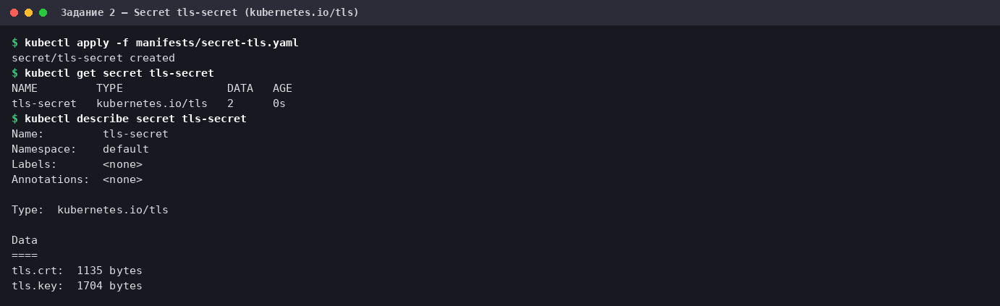

Тип `kubernetes.io/tls`, два ключа. `describe` показывает только размеры данных, а не сами значения.

### 2.3. Ingress

В этой версии MicroK8s аддон `ingress` ставит **Traefik** (через Helm), а не nginx-ingress, как было в более
старых версиях. Все три IngressClass (`nginx`, `public`, `traefik`) обслуживает один и тот же Traefik.

```bash
microk8s enable ingress
```

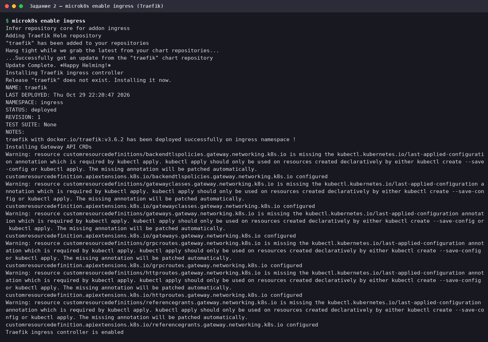

Вывод аддона обрезан на строке «Traefik ingress controller is enabled»: дальше он печатает пример Ingress. Предупреждения
про `last-applied-configuration` относятся к CRD Gateway API и безвредны.

```bash
kubectl rollout status daemonset/traefik -n ingress --timeout=300s
kubectl get pods,svc,ingressclass -n ingress
```

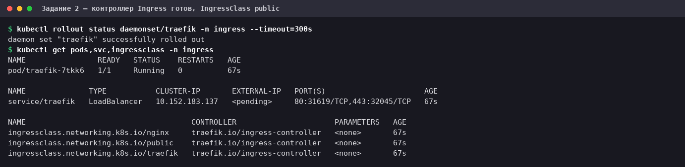

Traefik принимает трафик на `hostPort` 80 и 443 самой VM: в DaemonSet у портов `web` и `websecure` заданы
`hostPort: 80` и `hostPort: 443`. Слушающего сокета на хосте при этом нет (`ss -ltn` порты не показывает): `hostPort`
обычно реализуется правилами iptables на стороне CNI. Service типа LoadBalancer остаётся в `<pending>` — в MicroK8s
нет балансировщика, и это ни на что не влияет.

[`manifests/ingress-tls.yaml`](manifests/ingress-tls.yaml):

```yaml
apiVersion: networking.k8s.io/v1
kind: Ingress
metadata:
  name: web-app-ingress
spec:
  # в MicroK8s ingress-контроллер из аддона ingress обслуживает класс public
  ingressClassName: public
  tls:
    - hosts:
        - myapp.example.com
      secretName: tls-secret
  rules:
    - host: myapp.example.com
      http:
        paths:
          - path: /
            pathType: Prefix
            backend:
              service:
                name: web-app-svc
                port:
                  number: 80
```

Service [`manifests/service.yaml`](manifests/service.yaml), на который он смотрит:

```yaml
# Service для nginx из Pod'ов web-app: на него смотрит Ingress (задание 2)
apiVersion: v1
kind: Service
metadata:
  name: web-app-svc
spec:
  type: ClusterIP
  selector:
    app: web-app
  ports:
    - name: http
      port: 80
      targetPort: 80
```

```bash
kubectl apply -f manifests/ingress-tls.yaml
sleep 5; kubectl get ingress
kubectl describe ingress web-app-ingress
```

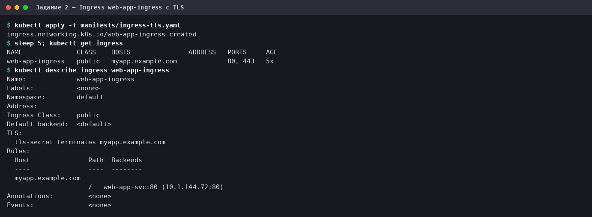

В `describe`: `tls-secret terminates myapp.example.com`, а бэкенд — Pod nginx. Колонка `ADDRESS` пуста по той же причине,
что и `<pending>` у Service Traefik.

### 2.4. Проверка HTTPS

Имя `myapp.example.com` не существует в DNS, а править `/etc/hosts` не нужно: ключ `curl --resolve` подставляет адрес VM
(`10.0.2.15`) для этого имени только в одном запросе.

```bash
curl -sk --resolve myapp.example.com:443:10.0.2.15 https://myapp.example.com/
curl -vk --resolve myapp.example.com:443:10.0.2.15 https://myapp.example.com/ 2>&1 | grep -E "subject:|issuer:|SSL connection|< HTTP/"
curl -sS --resolve myapp.example.com:443:10.0.2.15 https://myapp.example.com/
curl -s --cacert certs/tls.crt --resolve myapp.example.com:443:10.0.2.15 https://myapp.example.com/ | grep "<h1>"
curl -vk --resolve other.example.com:443:10.0.2.15 https://other.example.com/ 2>&1 | grep -E "subject:|< HTTP/"
```

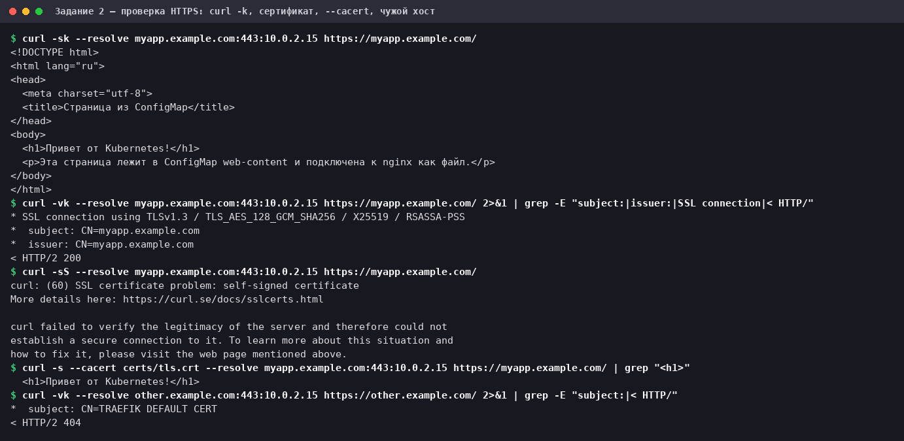

Просто `curl -k` проверку сертификата отключает, поэтому одного его мало. Вот что показывают пять запросов:

1. С `-k` страница из ConfigMap приходит по HTTPS.
2. Соединение TLS 1.3, HTTP/2 200 и отданный сертификат — **наш**: `subject: CN=myapp.example.com`.
3. Без `-k` curl справедливо отказывает: сертификат самоподписанный (`curl: (60)`).
4. С `--cacert certs/tls.crt` проверка проходит: самоподписанный сертификат является собственным корнем. Это значит, что
   сервер отдаёт именно сертификат из Secret.
5. Контрольный запрос с чужим именем хоста получает `TRAEFIK DEFAULT CERT` и 404: Ingress с нашим сертификатом
   срабатывает только для `myapp.example.com`.

## Задание 3. RBAC

### 3.1. Включение RBAC

```bash
microk8s enable rbac
microk8s status --wait-ready --timeout 120 | head -3
kubectl get nodes
kubectl get clusterrolebinding cluster-admin -o wide
```

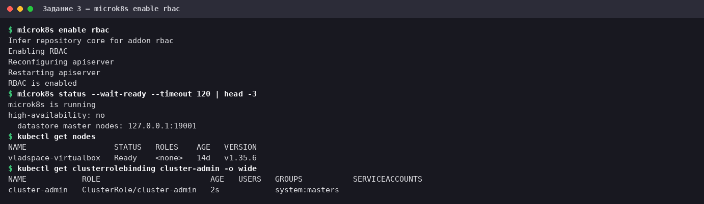

До включения в `/var/snap/microk8s/current/args/kube-apiserver` стояло `--authorization-mode=AlwaysAllow`: любому
аутентифицированному пользователю разрешалось всё, и Role с RoleBinding ничего не ограничивали бы. После включения стало
`--authorization-mode=RBAC,Node`. Админский доступ остался (группа `system:masters` привязана к `cluster-admin`), а
служебные Pod'ы кластера продолжили работать.

### 3.2. Сертификат пользователя

Имя пользователя в Kubernetes берётся из `CN` клиентского сертификата, а сертификат должен быть подписан CA кластера.
В MicroK8s это `/var/snap/microk8s/current/certs/ca.crt` и `ca.key`. Чтобы OpenSSL не создал файл серийных номеров
`ca.srl` внутри каталога кластера, я указываю `-CAserial` с путём в рабочем каталоге:

```bash
openssl genrsa -out certs/developer.key 2048 2>/dev/null
openssl req -new -key certs/developer.key -out certs/developer.csr -subj "/CN=developer"
openssl x509 -req -in certs/developer.csr -CA /var/snap/microk8s/current/certs/ca.crt -CAkey /var/snap/microk8s/current/certs/ca.key -CAserial certs/developer-ca.srl -CAcreateserial -out certs/developer.crt -days 365
openssl x509 -in certs/developer.crt -noout -subject -issuer -dates
openssl verify -CAfile /var/snap/microk8s/current/certs/ca.crt certs/developer.crt
```

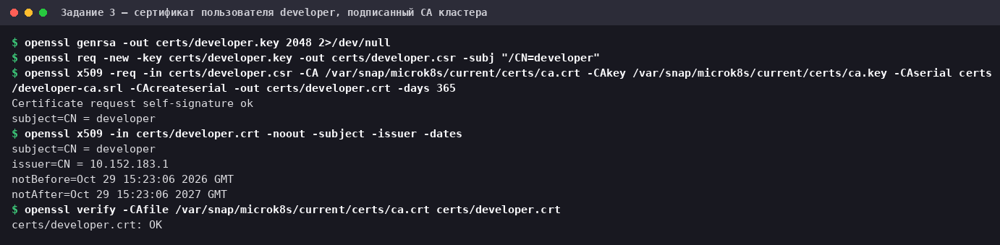

Сертификат подписан CA кластера (`issuer: CN = 10.152.183.1` — имя CA MicroK8s), `openssl verify` вернул `OK`.
В реальном кластере ключ CA админу в руки не дают, и сертификаты выпускают через API `CertificateSigningRequest`
(`kubectl certificate approve`). Здесь я следую заданию.

### 3.3. kubeconfig пользователя и состояние «до»

Чтобы проверять права по настоящему сертификату, а не только через подмену пользователя `--as`, делаю отдельный kubeconfig
для `developer` (он в `certs/`, в репозиторий не попадает):

```bash
kubectl config set-cluster microk8s --server=https://10.0.2.15:16443 --certificate-authority=/var/snap/microk8s/current/certs/ca.crt --embed-certs=true --kubeconfig=certs/developer.kubeconfig
kubectl config set-credentials developer --client-certificate=certs/developer.crt --client-key=certs/developer.key --embed-certs=true --kubeconfig=certs/developer.kubeconfig
kubectl config set-context developer --cluster=microk8s --user=developer --kubeconfig=certs/developer.kubeconfig
kubectl config use-context developer --kubeconfig=certs/developer.kubeconfig
kubectl auth whoami --kubeconfig=certs/developer.kubeconfig
kubectl get pods --kubeconfig=certs/developer.kubeconfig
kubectl get pods --as=developer
```

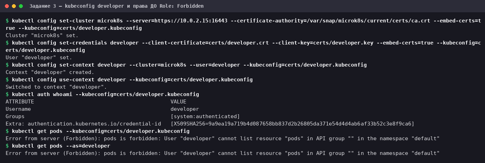

Пока Role нет, пользователь уже **аутентифицирован** (`kubectl auth whoami` → `developer`, группа
`system:authenticated`), но **не авторизован**: `Forbidden`. Это и ожидалось: по умолчанию RBAC ничего не разрешает.

### 3.4. Почему в Role нет глагола `describe`

В шаблоне Role среди `verbs` есть `describe`. Проверка на временной Role:

```bash
kubectl create role tmp-describe --verb=describe --resource=pods
kubectl create rolebinding tmp-describe --role=tmp-describe --user=tmpuser
kubectl auth can-i describe pods --as=tmpuser
kubectl auth can-i get pods --as=tmpuser
kubectl describe $(kubectl get pods -l app=web-app -o name) --as=tmpuser
kubectl delete rolebinding,role tmp-describe
```

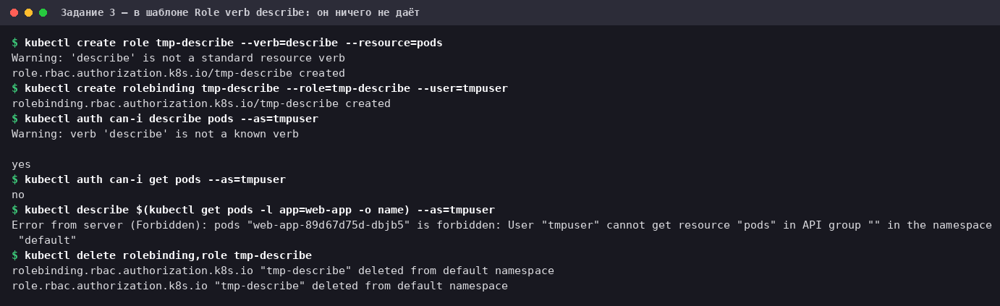

`kubectl` сам предупреждает `'describe' is not a standard resource verb`. API-сервер такую Role принимает, и
`can-i describe pods` отвечает `yes` (слово просто совпало), но `kubectl describe` падает с
`cannot get resource "pods"`. Дело в том, что `kubectl describe` посылает в API запросы `get`/`list`, поэтому
право на «описание» дают именно они. Временные Role и RoleBinding после проверки удалены.

### 3.5. Role и RoleBinding

[`manifests/role-pod-reader.yaml`](manifests/role-pod-reader.yaml):

```yaml
apiVersion: rbac.authorization.k8s.io/v1
kind: Role
metadata:
  name: pod-reader
  namespace: default # Role действует только в этом namespace
rules:
  - apiGroups: [""] # "" — core API group, там живут pods
    resources:
      - pods     # просмотр подов и их описания (kubectl get / describe)
      - pods/log # логи подов (kubectl logs)
    verbs:
      - get
      - list
      - watch
```

[`manifests/rolebinding-developer.yaml`](manifests/rolebinding-developer.yaml):

```yaml
apiVersion: rbac.authorization.k8s.io/v1
kind: RoleBinding
metadata:
  name: developer-pod-reader
  namespace: default
subjects:
  - kind: User
    name: developer # берётся из CN клиентского сертификата
    apiGroup: rbac.authorization.k8s.io
roleRef:
  kind: Role
  name: pod-reader
  apiGroup: rbac.authorization.k8s.io
```

```bash
kubectl apply -f manifests/role-pod-reader.yaml -f manifests/rolebinding-developer.yaml
kubectl get role,rolebinding
kubectl describe role pod-reader
kubectl describe rolebinding developer-pod-reader
```

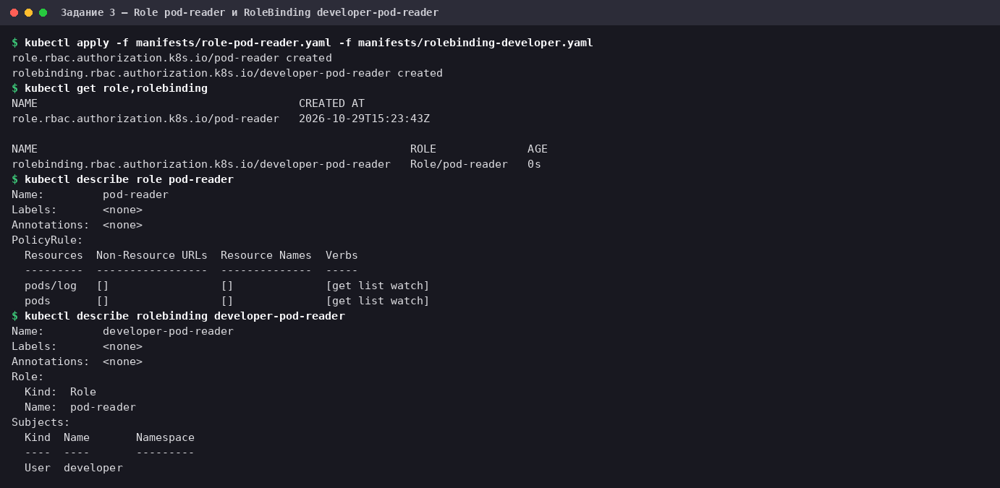

### 3.6. Проверка прав

Сначала так, как просит задание, — подменой пользователя `--as=developer`:

```bash
kubectl get pods --as=developer
kubectl describe pod -l app=web-app --as=developer | head -8
kubectl logs -l app=web-app -c nginx --tail=3 --as=developer
kubectl delete pod -l app=web-app --as=developer
kubectl get deployments --as=developer
kubectl get pods -n kube-system --as=developer
kubectl get secrets --as=developer
kubectl auth can-i --list --as=developer -n default | grep -v "^  "
```

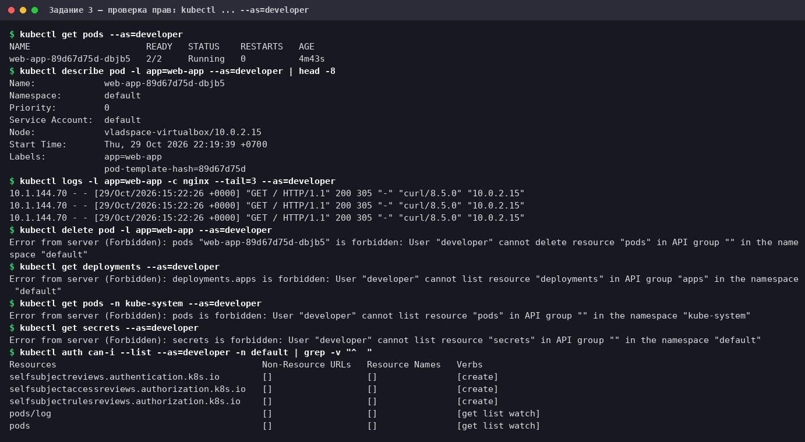

- **Разрешено:** `get pods`, `describe pod` и `logs`, то есть то, что требовалось.
- **Запрещено:** удаление Pod'а, другие ресурсы (`deployments`, `secrets`) и тот же `get pods` в другом namespace
  (`kube-system`): Role действует только в `default`. Pod после попытки удаления остался на месте.
- `auth can-i --list` показывает итоговые права: `pods` и `pods/log` с `get list watch`. Служебные права на создание
  `selfsubject*review` и общие права на URL вроде `/healthz` есть у любого аутентифицированного пользователя; я отфильтровал
  их `grep`'ом, чтобы они не заслоняли главное.

`--as` — это подмена пользователя админом, она проверяет только правила RBAC. Те же проверки по настоящему сертификату:

```bash
kubectl auth whoami --kubeconfig=certs/developer.kubeconfig
kubectl get pods --kubeconfig=certs/developer.kubeconfig
kubectl logs -l app=web-app -c multitool --tail=2 --kubeconfig=certs/developer.kubeconfig
kubectl delete pod -l app=web-app --kubeconfig=certs/developer.kubeconfig
kubectl get secrets --kubeconfig=certs/developer.kubeconfig
```

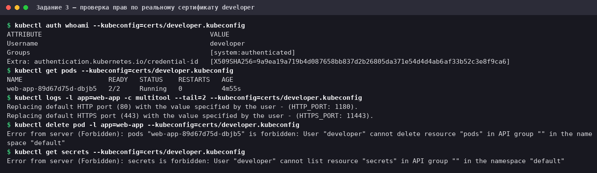

Результат тот же: просмотр и логи доступны, удаление и чтение секретов — `Forbidden`.

### 3.7. Нюанс: `describe` без событий

```bash
kubectl describe pod -l app=web-app | grep -A3 "^Events:" | cut -c1-120
kubectl describe pod -l app=web-app --as=developer | grep -A3 "^Events:"
kubectl get events --as=developer
```

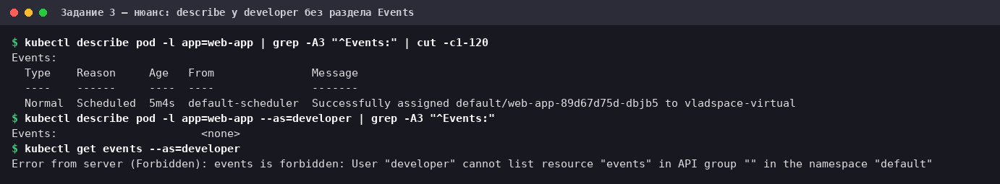

`kubectl describe pod` у `developer` работает, но раздел `Events:` пуст (`<none>`), хотя у админа события есть. События — отдельный
ресурс `events`, прав на него у Role нет, а `kubectl` не жалуется, а молча опускает раздел. Для диагностики
(`ImagePullBackOff`, ошибки монтирования) события важны. Я оставил Role ровно такой, как требует задание (только `pods`
и `pods/log`), чтобы не расширять права. Если нужно полноценное `describe`, достаточно добавить в `rules` ещё одно правило:

```yaml
  - apiGroups: [""]
    resources: ["events"]
    verbs: ["get", "list", "watch"]
```

## Как повторить и убрать

```bash
kubectl apply -f manifests/configmap-web.yaml -f manifests/deployment.yaml -f manifests/service.yaml
kubectl apply -f manifests/secret-tls.yaml -f manifests/ingress-tls.yaml   # нужен аддон ingress
kubectl apply -f manifests/role-pod-reader.yaml -f manifests/rolebinding-developer.yaml   # нужен rbac и сертификат developer

# удаление объектов ДЗ
kubectl delete -f manifests/
# аддоны возвращаются в исходное состояние (до ДЗ они были выключены)
microk8s disable ingress
microk8s disable rbac
```

Ссылка для сдачи: файл `README.md` этого репозитория.
